<!-- HEADER WITH TYPING EFFECT -->
<p align="center">
  
</p>

<p align="center">
  
</p>

---

### 🧙‍♂️ Who Am I?

```yaml
role: Full Stack Developer
interests:
  Full Stack Development
  - Frontend: React.js, Next.js, TypeScript, TailwindCSS
  - Backend: Node.js, Express.js, Nest.js, GraphQL, Python
  - Databases: PostgreSQL, MongoDB, Firebase
  - DevOps: Docker, AWS, Vercel
  - Version Control: Git, GitHub, CI/CD

  Web3 & Blockchain 
   - Smart Contracts: Solidity, Rust (Solana), Hardhat, Foundry
   - DeFi & Trading: CEX, DEX, Automated Market Makers (AMM), Trading Bots
   - Tools: Ethers.js, Web3.js, Moralis, IPFS

```
🛠️ Tech Stack
<table align="center">
  <tr>
    <td align="center" width="90">
      <a target="_blank" rel="noopener noreferrer nofollow" href="https://techstack-generator.vercel.app/js-icon.svg">
        
      </a><br>Javascript
    </td>
    <td align="center" width="90">
      <a href="https://skillicons.dev/icons?i=solidity" target="_blank">
        
      </a><br>Solidity
    </td>
    <td align="center" width="90">
      <a href="https://skillicons.dev/icons?i=rust" target="_blank">
        
      </a><br>Rust
    </td>
    <td align="center" width="90">
      <a href="https://techstack-generator.vercel.app/react-icon.svg" target="_blank">
        
      </a><br>React
    </td>
    <td align="center" width="90">
      <a href="https://skillicons.dev/icons?i=nextjs" target="_blank">
        
      </a><br>Next.js
    </td>
    <td align="center" width="90">
      <br>Ethereum
    </td>
    <td align="center" width="90">
      <br>Solana
    </td>
    <td align="center" width="90">
      <a href="https://techstack-generator.vercel.app/python-icon.svg" target="_blank">
      
      </a><br>Python
    </td>
    <td align="center" width="90">
      <a href="https://techstack-generator.vercel.app/ts-icon.svg" target="_blank">
        
      </a><br>Typescript
    </td>
    
  </tr>

  <tr>
    <td align="center" width="90">
      <a href="https://skillicons.dev/icons?i=firebase" target="_blank">
        
      </a><br>Firebase
    </td>
    <td align="center" width="90">
      <a href="https://skillicons.dev/icons?i=mongodb" target="_blank">
        
      </a><br>MongoDB
    </td>
    <td align="center" width="90">
      <a href="https://techstack-generator.vercel.app/mysql-icon.svg" target="_blank">
        
      </a><br>MySQL
    </td>
    <td align="center" width="90">
      <a href="https://skillicons.dev/icons?i=postgres" target="_blank">
        
      </a><br>PostgreSQL
    </td>
    <td align="center" width="90">
      <a href="https://skillicons.dev/icons?i=supabase" target="_blank">
        
      </a><br>Supabase
    </td>
    <td align="center" width="90">
      <a href="https://skillicons.dev/icons?i=materialui" target="_blank">
        
      </a><br>MaterialUI
    </td>
    <td align="center" width="90">
      <a href="https://skillicons.dev/icons?i=tailwind" target="_blank">
        
      </a><br>Tailwind
    </td>
    <td align="center" width="90">
      <a href="https://skillicons.dev/icons?i=threejs" target="_blank">
        
      </a><br>Three.js
    </td>
    <td align="center" width="90">
      <a href="https://techstack-generator.vercel.app/restapi-icon.svg" target="_blank">
        
      </a><br>REST API
    </td>
  </tr>
</table>


📊 GitHub Stats (Gradient Mode)
<p align="center">  </p>


<p align="center"><i>"Don’t just code it. Craft it."</i></p> <p align="center">  </p> <picture>
  <source media="(prefers-color-scheme: dark)" srcset="https://raw.githubusercontent.com/meta-success/meta-success/output/pacman-contribution-graph-dark.svg">
  <source media="(prefers-color-scheme: light)" srcset="https://raw.githubusercontent.com/meta-success/meta-success/output/pacman-contribution-graph.svg">
  
</picture><p align="center">  </p>
